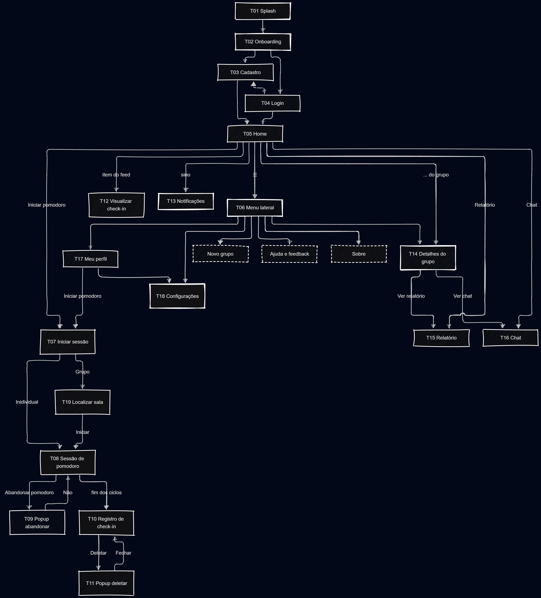
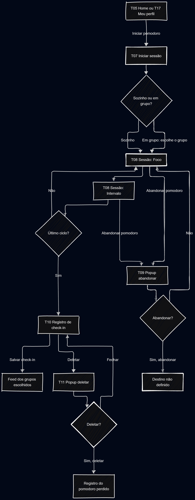

# Fluxos de navegação

> Como o usuário se move entre as telas do Pomomates, possuindo um diagrama geral do app 
> e um diagrama referente ao pomodoro especificamente. Os IDs (T01, T02, ...) seguem o [inventário de telas](screen-inventory.md).
> Este documento **descreve** o protótipo.

**Última atualização:** 2026-11-15
**Fase:** 1 — Consolidação do produto

## Legenda dos diagramas

Os diagramas são feitos pelo [Mermaid](https://mermaid.js.org) e exportados pelo [mermaid.live](https://mermaid.live) como `.png` em [`images/`](images/). O código-fonte de cada diagrama fica em `images/` com o mesmo nome e extensão `.mmd`, para poder editar depois.

| Elemento | Significado |
| --- | --- |
| Seta contínua | Navegação confirmada pelo protótipo ou pelo fluxo do Behance |
| Seta tracejada | Navegação interpretada a partir do design, ainda não confirmada |
| Caixa com borda tracejada | Tela citada, mas não desenhada |

---

## 1. Mapa geral

Todas as telas e as ligações entre elas.

---

## 2. Primeiro acesso

Do download até a Home.

**T01 Splash → T02 Onboarding (3 telas) → T03 Cadastro ou T04 Login → T05 Home.**

No onboarding, "Próximo" avança entre as telas, e "Pular" (telas 1 e 2) e "Começar!" (tela 3) encerram a sequência. Cadastro e Login se ligam pelos links "Já tenho uma conta" e "Novo cadastro".

**Observado:** a sequência do onboarding, os botões "Pular", "Próximo" e "Começar!", e os links entre Cadastro e Login.
**Em aberto:** o destino após o onboarding (o fluxo do Behance vai direto para a Home, sem passar por autenticação), se o onboarding aparece só no primeiro acesso e o destino após o cadastro.

---

## 3. Sessão de pomodoro e check-in

O fluxo central do produto.

**Observado:** a escolha entre Sozinho e Em grupo, os estados de foco e pausa com contador de ciclos, a confirmação para abandonar, a tela "Pomodoro concluído!" com compartilhamento em vários grupos e o aviso de que deletar apaga o registro do pomodoro.
**Em aberto:** a transição exata do último ciclo para o check-in, o destino após abandonar, a pausa longa e como funciona a sala da sessão em grupo.

---

## 4. Grupo: relatório e chat

Há dois caminhos até o Relatório (T15) e o Chat (T16):

- **Pela Home (T05):** botões "Relatório" e "Chat" da barra inferior.
- **Pelo grupo:** Menu lateral (T06) ou "..." do cartão da Home → Detalhes do grupo (T14) → "Ver relatório" ou "Ver chat".

**Em aberto:** qual grupo é aberto pela barra inferior da Home quando o usuário participa de vários.

---

## 5. Comparação com o fluxo do Behance

O estudo de caso traz um fluxo do usuário do MVP. A tabela mostra como cada etapa dele aparece no protótipo.

| Etapa no Behance | Tela no protótipo | Situação |
| --- | --- | --- |
| Splash screen | T01 | ✅ Desenhada |
| Onboarding | T02 | ✅ Desenhada |
| Início / meu feed | T05 | ✅ Desenhada |
| Criar grupo de amigos | "Novo grupo" (T06) | ⚠️ Citada, não desenhada |
| Feed do grupo | — | ⚠️ Não identificada. Pode ser o feed da Home |
| Relatório geral (ranking semanal) | T15 | ✅ Desenhada |
| Chat do grupo | T16 | ✅ Desenhada |
| Iniciar pomodoro em grupo | T07 | ✅ Desenhada |
| Iniciar um pomodoro | T07 → T08 | ✅ Desenhada |
| Fazer check-in (foto opcional) | T10 | ✅ Desenhada |
| Notificações | T13 | ✅ Desenhada (só o estado vazio) |
| Menu lateral | T06 | ✅ Desenhada |
| Meu perfil | T17 | ✅ Desenhada |
| Configurações | T18 | ✅ Desenhada |
| Relatório de progresso | — | ⚠️ Não identificado. Pode ser o calendário de T17 |
| — | T03 Cadastro, T04 Login | ➕ Existem no protótipo, mas não no fluxo |
| — | T12 Visualizar check-in | ➕ Existe no protótipo, mas não no fluxo |
