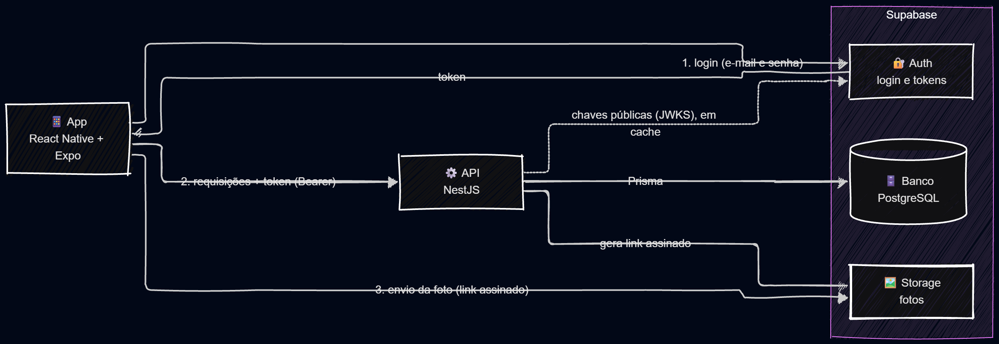

# Arquitetura

> Como o Pomomates é organizado: as partes do sistema, os módulos do backend e as regras que valem para todos eles.
> Baseado nos [ADRs](decisions/) e nos [aprendizados da prova de conceito](poc-learnings.md).

**Última atualização:** 2026-11-19
**Fase:** 5 — Arquitetura

## 1. Visão geral



| Parte | Tecnologia | Responsabilidade |
| --- | --- | --- |
| **App** | React Native + Expo | Interface, timer da sessão, câmera, login |
| **Supabase Auth** | Supabase | Cadastro, login e emissão dos tokens |
| **API** | NestJS | Todas as regras de negócio |
| **Banco** | PostgreSQL (Supabase) | Dados, acessados só pela API, via Prisma |
| **Storage** | Supabase Storage | Fotos dos check-ins e de perfil |

**Como as partes conversam:**

1. O app faz login direto no **Supabase Auth** e recebe um token (ADR 0003).
2. Toda requisição do app à **API** leva esse token no cabeçalho `Authorization: Bearer`.
3. A API confere o token com as chaves públicas do Supabase e acessa o **banco** pelo Prisma.
4. O app **nunca** acessa o banco direto. As tabelas têm RLS ativado para bloquear a API pública do Supabase.

## 2. Módulos do backend

Cada funcionalidade é um módulo do NestJS, com o seu controller e o seu service.

### Infraestrutura

Usados pelo app inteiro.

| Módulo | Responsabilidade |
| --- | --- |
| `config` | Lê as variáveis de ambiente (global) |
| `prisma` | Conexão com o banco (global) |
| `auth` | Guard de autenticação e decorator `@CurrentUser()` |
| `storage` | Gera os links de envio das fotos para o Supabase Storage |
| `health` | Health check (`GET /health`) |

### Negócio (MVP)

| Módulo | Responsabilidade | Usa | Telas |
| --- | --- | --- | --- |
| `profiles` | Perfil e configurações de pomodoro do usuário | — | T17, T18 |
| `groups` | Grupos, membros e entrada em grupos | `profiles` | T06, T14 |
| `sessions` | Sessões de pomodoro: início, conclusão e abandono | `profiles` | T07, T08, T09 |
| `check-ins` | Check-ins, compartilhamento nos grupos e feed | `sessions`, `groups`, `storage` | T05, T10, T11, T12 |
| `comments` | Comentários nos check-ins | `check-ins` | T12 |
| `ranking` | Ranking semanal do grupo | `check-ins`, `groups` | T15 |

**Regra de dependência:** os módulos dependem só "para baixo" na tabela. Nenhum módulo depende de outro que está abaixo dele. Assim, não surgem dependências circulares (A precisa de B, que precisa de A).

### Depois do MVP

| Módulo | Motivo de ficar para depois |
| --- | --- |
| `chat` | Exige comunicação em tempo real (WebSockets) |
| `notifications` | Exige integração com o serviço de push |
| `rooms` | A sessão em grupo sincronizada, com tempo real |

## 3. Camadas dentro de um módulo

```
Controller  ── recebe a requisição, valida os dados, chama o service
    │
Service     ── aplica as regras de negócio
    │
Prisma      ── acessa o banco
```

- **Controller:** só HTTP. Rotas, validação da entrada e formato da resposta. Nenhuma regra de negócio.
- **Service:** todas as regras. É o que os testes unitários cobrem.
- **Prisma:** o service usa o `PrismaService` direto. **Não haverá uma camada extra de repositório**: o Prisma já cumpre esse papel, e uma camada a mais seria complexidade sem ganho neste tamanho de projeto.

## 4. Regras que valem para todos os módulos

### Autenticação: protegida por padrão (proposta)

Um **guard global** exige token em todas as rotas. As poucas rotas públicas, como `/health`, recebem o decorator `@Public()`.

**Por quê:** com o `@UseGuards` em cada controller, esquecer o guard num controller novo deixa a rota aberta. Com o guard global, o erro mais provável passa a ser uma rota fechada por engano, o que é muito menos grave.

### Criação do perfil (proposta)

O perfil é criado **automaticamente no primeiro `GET /me`**. No cadastro (T03), o app envia o nome ao Supabase Auth como dado do usuário; esse dado vem dentro do token, e a API usa o nome para criar o perfil.

**Por quê:** não exige nenhuma ligação extra entre o Supabase e a API. O primeiro acesso do usuário já cria tudo.

### Validação dos dados de entrada (proposta)

Todo dado recebido pela API é validado por um schema antes de chegar ao service. Proposta: usar **Zod**, que o NestJS 12 aceita nativamente. Os mesmos schemas podem ser reaproveitados no app, já que os dois usam TypeScript.

### Fotos (proposta)

O upload **não passa pela API**:

1. O app pede à API um link de envio (`POST /check-ins/upload-url`).
2. A API gera um **link assinado** no Supabase Storage, válido por poucos minutos.
3. O app envia a foto direto para o Storage, usando esse link.
4. O app cria o check-in informando o caminho da foto.

**Por quê:** fotos são arquivos grandes. Passar por dentro da API aumentaria o uso de memória e de banda do servidor sem nenhum ganho.

### Sessões de pomodoro e prevenção de fraude

O **timer roda no app** (ADR 0004). Mas a API registra o horário de início, pelo relógio do servidor, e só aceita a conclusão de uma sessão se tiver passado o tempo mínimo previsto. Isso impede que alguém conclua sessões instantaneamente para subir no ranking, um dos riscos levantados no estudo de caso.

### Datas e horários

Todas as datas são guardadas em **UTC** no banco. O fuso usado para definir o "dia" e a "semana" do ranking ainda depende de uma resposta da equipe.

### Erros

Os erros seguem o formato padrão do NestJS: `statusCode`, `message` e `error`. Os services lançam as exceções do Nest (`NotFoundException`, `ForbiddenException`...), que viram a resposta HTTP correspondente.

## 5. Estrutura de pastas do backend

```
backend/src/
├── main.ts
├── app.module.ts
├── auth/            guard, decorators (@CurrentUser, @Public)
├── prisma/          PrismaModule e PrismaService
├── storage/
├── health/
├── profiles/
├── groups/
├── sessions/
├── check-ins/
├── comments/
├── ranking/
└── generated/       Prisma Client (gerado, fora do Git)
```

Cada pasta de módulo segue o mesmo padrão:

```
groups/
├── groups.module.ts
├── groups.controller.ts
├── groups.service.ts
├── groups.service.spec.ts
└── schemas/          schemas de validação da entrada
```
