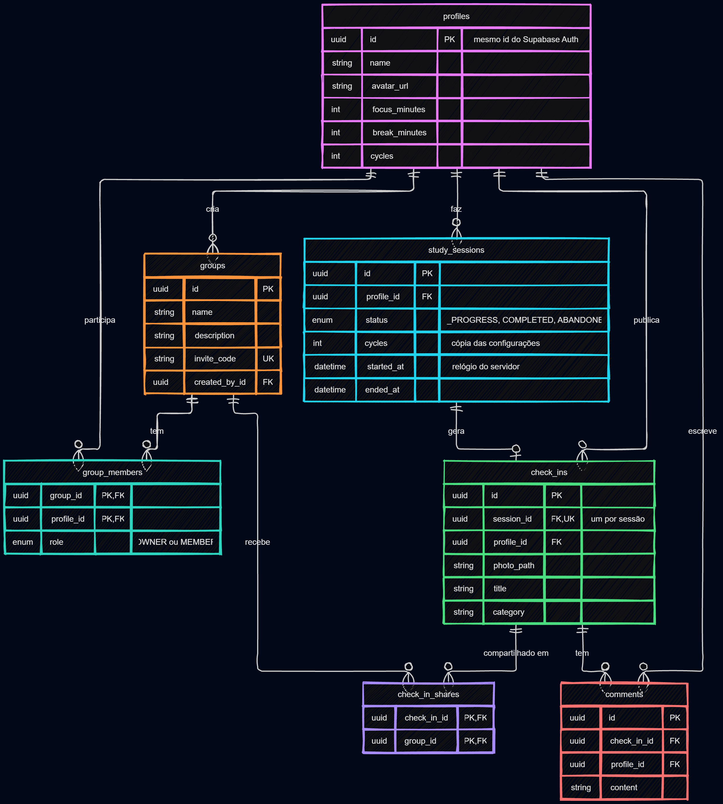

# Modelo de dados

> As tabelas do MVP, os relacionamentos entre elas e as regras de integridade.
> Os nomes seguem o [glossário](../01-product/glossary.md). O escopo segue o [escopo do MVP](../01-product/mvp-scope.md).

**Última atualização:** 2026-11-19
**Fase:** 6 — Modelagem de dados

## Convenções

- **Nomes:** camelCase no código (`focusMinutes`), snake_case no banco (`focus_minutes`), com `@map` e `@@map`.
- **Ids:** UUID em todas as tabelas. O id do perfil é o mesmo do usuário no Supabase Auth.
- **Datas:** sempre em UTC.
- **RLS:** toda tabela nova tem RLS ativado na migration, para bloquear a API pública do Supabase.
- **Exclusão:** ao apagar um registro, os registros que dependem dele são apagados junto (`onDelete: Cascade`), salvo indicação contrária.

### Como ler o diagrama

Cada linha liga duas tabelas, e os símbolos nas pontas indicam **quantos registros de cada lado** podem estar ligados.

| Símbolo na ponta | No código Mermaid | Significado |
| --- | --- | --- |
| Dois traços | `\|\|` | Exatamente um |
| Círculo e traço | `o\|` | Zero ou um |
| Traço e "pé de galinha" | `\|{` | Um ou muitos |
| Círculo e "pé de galinha" | `o{` | Zero ou muitos |

O **círculo** indica que a relação é opcional (pode ser zero). O **"pé de galinha"**, as três linhas abertas, indica "muitos".

Exemplos no Pomomates:

| Relação | Como ler |
| --- | --- |
| `profiles \|\|--o{ study_sessions` | Cada sessão pertence a exatamente um usuário; um usuário pode ter zero ou muitas sessões |
| `study_sessions \|\|--o\| check_ins` | Cada check-in pertence a exatamente uma sessão; uma sessão gera zero ou um check-in |
| `groups \|\|--o{ group_members` | Cada vínculo de membro pertence a exatamente um grupo; um grupo pode ter zero ou muitos membros |

**Siglas nas colunas:**

| Sigla | Significado |
| --- | --- |
| `PK` | *Primary key* (chave primária): identifica cada registro |
| `FK` | *Foreign key* (chave estrangeira): aponta para um registro de outra tabela |
| `UK` | *Unique key*: o valor não pode se repetir na tabela |

## Diagrama



## Entidades

| Tabela | O que guarda | Telas |
| --- | --- | --- |
| `profiles` | Perfil e configurações de pomodoro do usuário | T17, T18 |
| `groups` | Grupos de estudo | T06, T14 |
| `group_members` | Quem participa de qual grupo, e com qual papel | T14 |
| `study_sessions` | Cada sessão de pomodoro iniciada | T07, T08, T09 |
| `check_ins` | O registro de uma sessão concluída | T10, T12 |
| `check_in_shares` | Em quais grupos cada check-in foi compartilhado | T10, T05 |
| `comments` | Comentários nos check-ins | T12 |

## Relacionamentos

| Relação | Tipo | Leitura |
| --- | --- | --- |
| `profiles` ↔ `groups` | Muitos para muitos, via `group_members` | Um usuário participa de vários grupos; um grupo tem vários membros |
| `profiles` → `study_sessions` | Um para muitos | Um usuário faz várias sessões |
| `study_sessions` → `check_ins` | Um para um | Cada sessão concluída gera no máximo um check-in |
| `check_ins` ↔ `groups` | Muitos para muitos, via `check_in_shares` | Um check-in pode ir para vários grupos; um grupo recebe vários check-ins |
| `check_ins` → `comments` | Um para muitos | Um check-in tem vários comentários |
| `profiles` → `comments` | Um para muitos | Um usuário escreve vários comentários |

## O que não vira tabela

| Conceito | Como é obtido | Por quê |
| --- | --- | --- |
| **Ranking semanal** | Calculado na hora: conta os check-ins compartilhados no grupo durante a semana | Uma tabela de ranking ficaria desatualizada a cada novo check-in. Calcular é simples e sempre correto |
| **Streak** | Calculado a partir das datas dos check-ins | Pelo mesmo motivo (D17) |
| **Total de check-ins**, **minutos de pomodoro** | Calculados com contagens e somas | Pelo mesmo motivo (D18, D19) |

Se o volume de dados crescer e esses cálculos ficarem lentos, a solução é guardar os resultados em cache, sem mudar o modelo.

## Decisões de modelagem

**A sessão guarda uma cópia das configurações.** `study_sessions` registra os ciclos e os minutos de foco e de intervalo **no momento em que começou**. Se o usuário mudar as configurações depois, as sessões antigas continuam corretas. Esse padrão se chama *snapshot*.

**O horário de início vem do servidor.** O `started_at` é preenchido pela API, não pelo app. É a base da prevenção de fraude: a API só aceita concluir a sessão depois do tempo mínimo (ver [arquitetura](../03-architecture/architecture-overview.md)).

**Um check-in por sessão.** O `session_id` do check-in é único. Isso impede registrar dois check-ins da mesma sessão para ganhar pontos no ranking.

**O compartilhamento é uma tabela própria.** O ranking e o feed de cada grupo saem de `check_in_shares`, que diz em quais grupos cada check-in aparece.

## Suposições a confirmar

| Ponto do modelo | Suposição atual | Dúvida |
| --- | --- | --- |
| `check_ins.photo_path` | Opcional | D01 |
| Ranking | Conta check-ins compartilhados no grupo, um por sessão | D02, D15 |
| Semana do ranking | De segunda a domingo, no fuso de São Paulo | D03 |
| Histórico do ranking | Não é guardado no MVP | D04 |
| Entrada em grupos | Por código de convite (`groups.invite_code`) | D11 |
| Papéis no grupo | Dono (quem criou) e membro | D11, D12 |
| `check_ins.category` | Texto livre por enquanto; vira uma lista fixa quando a equipe definir as categorias | D20 |
| Sessão em grupo | Fora do MVP. O campo `mode` já existe, para não exigir mudança depois | D05–D07 |
| Deletar check-in | Apaga também a sessão ("você perderá o registro do pomodoro", T11) | D22 |

## Schema (por enquanto)

```prisma
enum SessionMode {
  SOLO
  GROUP // depois do MVP
}

enum SessionStatus {
  IN_PROGRESS
  COMPLETED
  ABANDONED
}

enum GroupRole {
  OWNER
  MEMBER
}

model Profile {
  id           String   @id @db.Uuid // mesmo id do usuário no Supabase Auth
  name         String
  avatarUrl    String?  @map("avatar_url")
  focusMinutes Int      @default(25) @map("focus_minutes")
  breakMinutes Int      @default(5) @map("break_minutes")
  cycles       Int      @default(4)
  createdAt    DateTime @default(now()) @map("created_at")
  updatedAt    DateTime @updatedAt @map("updated_at")

  memberships   GroupMember[]
  sessions      StudySession[]
  checkIns      CheckIn[]
  comments      Comment[]
  createdGroups Group[]

  @@map("profiles")
}

model Group {
  id          String   @id @default(uuid()) @db.Uuid
  name        String
  description String?
  coverUrl    String?  @map("cover_url")
  inviteCode  String   @unique @map("invite_code") // código para entrar no grupo (D11)
  createdById String   @map("created_by_id") @db.Uuid
  createdAt   DateTime @default(now()) @map("created_at")
  updatedAt   DateTime @updatedAt @map("updated_at")

  createdBy Profile        @relation(fields: [createdById], references: [id])
  members   GroupMember[]
  shares    CheckInShare[]

  @@map("groups")
}

model GroupMember {
  groupId   String    @map("group_id") @db.Uuid
  profileId String    @map("profile_id") @db.Uuid
  role      GroupRole @default(MEMBER)
  joinedAt  DateTime  @default(now()) @map("joined_at")

  group   Group   @relation(fields: [groupId], references: [id], onDelete: Cascade)
  profile Profile @relation(fields: [profileId], references: [id], onDelete: Cascade)

  @@id([groupId, profileId]) // um usuário entra uma vez só em cada grupo
  @@index([profileId])       // "quais são os meus grupos?"
  @@map("group_members")
}

model StudySession {
  id           String        @id @default(uuid()) @db.Uuid
  profileId    String        @map("profile_id") @db.Uuid
  mode         SessionMode   @default(SOLO)
  status       SessionStatus @default(IN_PROGRESS)
  cycles       Int           // cópia das configurações no início da sessão
  focusMinutes Int           @map("focus_minutes")
  breakMinutes Int           @map("break_minutes")
  startedAt    DateTime      @default(now()) @map("started_at") // relógio do servidor
  endedAt      DateTime?     @map("ended_at")

  profile Profile  @relation(fields: [profileId], references: [id], onDelete: Cascade)
  checkIn CheckIn?

  @@index([profileId, startedAt])
  @@map("study_sessions")
}

model CheckIn {
  id          String   @id @default(uuid()) @db.Uuid
  sessionId   String   @unique @map("session_id") @db.Uuid // um check-in por sessão
  profileId   String   @map("profile_id") @db.Uuid
  photoPath   String?  @map("photo_path") // caminho no Supabase Storage (D01)
  title       String?
  description String?
  category    String   @default("Estudo") // lista fixa quando a equipe definir (D20)
  createdAt   DateTime @default(now()) @map("created_at")

  session  StudySession   @relation(fields: [sessionId], references: [id], onDelete: Cascade)
  profile  Profile        @relation(fields: [profileId], references: [id], onDelete: Cascade)
  shares   CheckInShare[]
  comments Comment[]

  @@index([profileId, createdAt]) // calendário do perfil e streak
  @@map("check_ins")
}

model CheckInShare {
  checkInId String   @map("check_in_id") @db.Uuid
  groupId   String   @map("group_id") @db.Uuid
  createdAt DateTime @default(now()) @map("created_at")

  checkIn CheckIn @relation(fields: [checkInId], references: [id], onDelete: Cascade)
  group   Group   @relation(fields: [groupId], references: [id], onDelete: Cascade)

  @@id([checkInId, groupId])     // o mesmo check-in vai uma vez só para cada grupo
  @@index([groupId, createdAt])  // feed e ranking do grupo
  @@map("check_in_shares")
}

model Comment {
  id        String   @id @default(uuid()) @db.Uuid
  checkInId String   @map("check_in_id") @db.Uuid
  profileId String   @map("profile_id") @db.Uuid
  content   String
  createdAt DateTime @default(now()) @map("created_at")
  updatedAt DateTime @updatedAt @map("updated_at")

  checkIn CheckIn @relation(fields: [checkInId], references: [id], onDelete: Cascade)
  profile Profile @relation(fields: [profileId], references: [id], onDelete: Cascade)

  @@index([checkInId, createdAt])
  @@map("comments")
}
```
